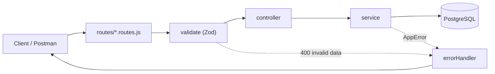

<!-- # Architecture and installation -->

## Code architecture



| Layer | Responsibility |
| --- | --- |
| `app.js` | Assembles Express: helmet, cors, morgan, the JSON parser, routes, and the error handler. Exported without `listen()` so tests can use it directly |
| `index.js` | Runs `app.listen()`, checks the database connection, and handles shutdown |
| `routes` | Defines URLs and methods, and attaches the validation middleware |
| `middlewares/validate.js` | Checks `:id` and the body against Zod schemas, then replaces `req.body` with the validated result (text is trimmed, email is lowercased) |
| `controllers` | Receive requests and send JSON responses |
| `services` | Run PostgreSQL queries and business rules |
| `core/dbError.js` | Translates PostgreSQL errors (unique, foreign key, check, not null, data format) into readable messages |
| `middlewares/errorHandler.js` | Turns errors into a uniform JSON response |

Because the five CRUD routes are the same for every table, the code is written once in `core/`:

- **`BaseService`** takes a table configuration (table name, label for messages, writable columns, SELECT query with JOINs, id column, ordering, and an `updated_at` column if present) and provides `findAll`, `findById`, `create`, `update`, and `delete`. Queries use parameters (`$1`, `$2`, ...), and column names come from the column list in the service, not from user input. The results of `create` and `update` are re-read through the base SELECT query, so the response already includes the JOINed columns.
- **`BaseController`** calls the service and builds the JSON response.
- **`createCrudRouter`** mounts the 5 routes together with their validation middleware.

Resources that need special rules just override the methods they need:

- `akun-warga.service.js`: the password from the client is hashed with bcrypt (cost 10) before being saved, through the `prepare` hook. `password_hash` is not in the response because it is not part of the SELECT query.
- `pendaftaran-kegiatan.service.js`: a new registration is only accepted if the activity has status `dijadwalkan` and the number of registrants has not reached the quota.
- `kegiatan.service.js`: the `updated_at` column is refreshed every time data is changed through PUT.

Adding a new resource only takes one schema, service, controller, and route file, then registering the route in `src/routes/index.js`.

A few other details:

- `DATE` columns are read as `YYYY-MM-DD` text so they do not shift because of time zones (`src/config/db.js`).
- `GET /` lists the available resources.
- On `SIGINT` (Ctrl+C) or `SIGTERM`, the server stops accepting requests and then closes the database connection (`src/index.js`).
- morgan request logging is disabled when `NODE_ENV` is `production` or `test`.

### Technology

| Need | Library |
| --- | --- |
| Web framework | Express 5 |
| Database | PostgreSQL (`pg` driver) |
| Input validation | Zod 4 |
| Password hashing | bcryptjs |
| Security headers and CORS | helmet, cors (default configuration) |
| Request logging | morgan |
| Configuration | dotenv |
| Auto restart during development | nodemon |
| Automated tests | Mocha 12, Chai 6, Supertest |
| Test reports | allure-mocha, allure-js-commons, Allure 3 (CLI) |
| API tests through Postman | Postman, Newman, newman-reporter-htmlextra |

The project uses ES Modules (`import ... from`) and requires Node.js 22.12 or newer (`engines` in `package.json`).

> [!NOTE]
> The `jsonwebtoken` and `express-rate-limit` packages are already listed in `dependencies` for the [roadmap](../README.md#roadmap), but they are not used in the code yet. The API has no authentication or rate limiting.

## Full installation

**1. Clone the repository and install dependencies**

```bash
git clone https://github.com/Ghifariezra/kegiatan-desa-rest-api.git
cd kegiatan-desa-rest-api
npm install
```

**2. Create the database**

```bash
psql -U postgres -h localhost -p 5432 -c "CREATE DATABASE kegiatan_desa;"
```

The test database is created separately, see [Running the Mocha tests](testing.md#running-the-mocha-tests).

**3. Set up the `.env` file**

Copy `.env.example` to `.env`, then adjust its contents:

| Variable | Example | Description |
| --- | --- | --- |
| `PORT` | `3000` | Server port |
| `DB_HOST` | `localhost` | PostgreSQL host |
| `DB_PORT` | `5432` | PostgreSQL port |
| `DB_USER` | `postgres` | PostgreSQL user |
| `DB_PASSWORD` | `password_postgres_kamu` | PostgreSQL password |
| `DB_NAME` | `kegiatan_desa` | Database name used to run the application |
| `DB_NAME_TEST` | `kegiatan_desa_test` | Database name used for tests. Must end in `_test`. If empty, `<DB_NAME>_test` is used |
| `NODE_ENV` | `production` | Optional. If `production`, morgan request logging is turned off |

> [!WARNING]
> The `.env` file contains database credentials and is already listed in `.gitignore`. Never commit it.

**4. Create the tables and load sample data**

```bash
npm run db:reset
```

This runs `reset.sql`, `schema.sql`, then `seed.sql` in order through `psql`, using the credentials from `.env` (`DB_NAME` and `DB_PASSWORD` are required). It stops if any SQL file fails. Check the result with `\dt` inside psql. 8 tables should appear.

> [!WARNING]
> `db:reset` deletes all tables and everything in them. Stop the server (`npm start` or `npm run dev`) first so `DROP TABLE` is not blocked by connections that are still active.

**5. Start the server**

| Command | Purpose |
| --- | --- |
| `npm run dev` | Development mode, restarts automatically when files change (nodemon) |
| `npm start` | Normal mode (`node src/index.js`) |

If it succeeds, the terminal shows (these messages are printed by the app in Indonesian):

```
Server berjalan di http://localhost:3000
Terhubung ke database "kegiatan_desa"
```

If the database connection fails, the server keeps running and the terminal shows the message `Gagal terhubung ke database. Periksa isi file .env` ("Failed to connect to the database. Check the .env file"). Open `http://localhost:3000` to see the list of available resources.

### npm scripts

| Command | Purpose |
| --- | --- |
| `npm start` | Runs the server |
| `npm run dev` | Runs the server with nodemon |
| `npm test` | Runs the Mocha tests in parallel (separate database per worker) |
| `npm run test:serial` | Runs the Mocha tests one at a time (uses the `DB_NAME_TEST` database) |
| `npm run test:watch` | Mocha in serial mode, re-run whenever files in `src` or `tests` change |
| `npm run test:report` | Runs the tests with the Allure reporter, then builds the HTML report in `allure-report/` |
| `npm run report:open` | Opens the Allure report in the browser |
| `npm run test:api` | Runs the Postman collection with Newman (the server must be running) |
| `npm run test:api:report` | Same as `test:api`, plus an HTML report at `postman/report.html` |
| `npm run db:reset` | Drops all tables, then recreates the tables and sample data |