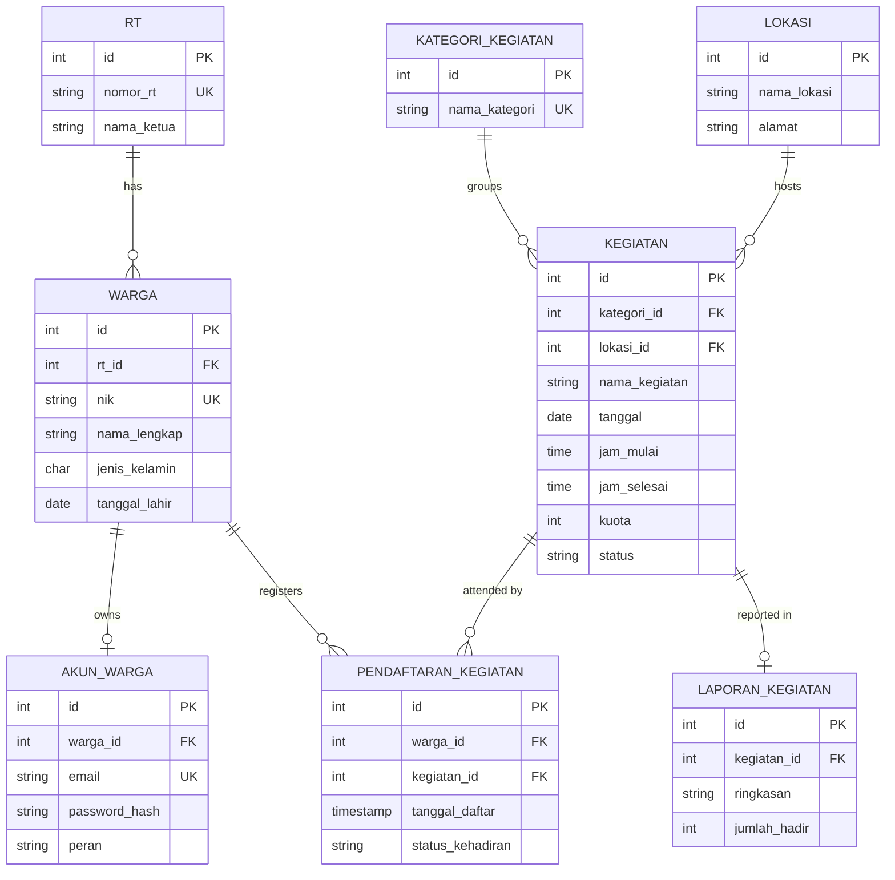

<!-- # Database and folder structure -->

## Database design

| Table | Contents |
| --- | --- |
| `rt` | Neighborhood units (Rukun Tetangga) |
| `warga` | Village residents |
| `akun_warga` | Resident accounts |
| `kategori_kegiatan` | Activity types (community clean-up, neighborhood watch, and others) |
| `lokasi` | Activity locations |
| `kegiatan` | Village activity schedule |
| `pendaftaran_kegiatan` | Residents registered for activities |
| `laporan_kegiatan` | Activity result reports |



The diagram above only shows the main columns. The full column list is in `database/schema.sql`.

### Relations

| Relation type | Tables | Description |
| --- | --- | --- |
| One to one | `warga` - `akun_warga` | A resident has only one account (`warga_id` is UNIQUE) |
| One to one | `kegiatan` - `laporan_kegiatan` | An activity has only one report (`kegiatan_id` is UNIQUE) |
| One to many | `rt` - `warga` | One RT has many residents |
| One to many | `kategori_kegiatan` - `kegiatan` | One category has many activities |
| One to many | `lokasi` - `kegiatan` | One location is used by many activities |
| Many to many | `warga` - `kegiatan` | Through the `pendaftaran_kegiatan` table; the `warga_id` and `kegiatan_id` pair is UNIQUE |

### Delete rules (ON DELETE)

| Deleting | Effect |
| --- | --- |
| An `rt` that still has residents | Rejected (409) |
| A `kategori_kegiatan` or `lokasi` still used by activities | Rejected (409) |
| A `warga` | The resident's account and registrations are deleted too |
| A `kegiatan` | The activity's registrations and report are deleted too |

### CHECK constraints in the database

| Table | Rule |
| --- | --- |
| `warga` | `jenis_kelamin` can only be `L` or `P` |
| `akun_warga` | `peran` can only be `warga` or `admin` |
| `kegiatan` | `kuota > 0`, `jam_selesai > jam_mulai`, `status` is one of `dijadwalkan`, `berlangsung`, `selesai`, `dibatalkan` |
| `pendaftaran_kegiatan` | `status_kehadiran` is one of `terdaftar`, `hadir`, `tidak_hadir` |
| `laporan_kegiatan` | `jumlah_hadir >= 0` |

### Sample data (`seed.sql`)

| Table | Count | Notes |
| --- | --- | --- |
| `rt` | 3 | RT 001 to 003 |
| `warga` | 6 | Spread across 3 RTs |
| `akun_warga` | 3 | Belong to residents with id 1, 2, and 4 |
| `kategori_kegiatan` | 4 | Kerja Bakti, Siskamling, Posyandu, Perayaan |
| `lokasi` | 4 | Village hall, field, watch post, drainage channel |
| `kegiatan` | 4 | 3 with status `dijadwalkan`, 1 `selesai` (id 4) |
| `pendaftaran_kegiatan` | 10 | Many to many between residents and activities |
| `laporan_kegiatan` | 1 | For activity id 4 |

> [!NOTE]
> All names, NIKs, phone numbers, and emails in the sample data are fictional. The `password_hash` values in the seed are only examples, not hashes of passwords that can be used to log in.

The SQL files are in the `database` folder:

| File | Purpose |
| --- | --- |
| `schema.sql` | Creates the 8 tables with their relations and constraints |
| `seed.sql` | Loads the sample data |
| `reset.sql` | Drops all tables (`DROP TABLE`) to start over |
| `diagram.dbml` | DBML version, can be imported into [dbdiagram.io](https://dbdiagram.io) |

## Folder structure

```
kegiatan-desa-rest-api/
├── database/
│   ├── schema.sql                     # creates tables and relations
│   ├── seed.sql                       # sample data
│   ├── reset.sql                      # drops all tables
│   └── diagram.dbml                   # diagram for dbdiagram.io
├── docs/                              # full documentation (README.md links here)
│   ├── api.md
│   ├── architecture.md
│   ├── database.md
│   └── testing.md
├── postman/
│   └── API - Desa Sukamaju.postman_collection.json
├── scripts/
│   ├── db-reset.mjs                   # runs reset.sql, schema.sql, seed.sql
│   └── test-report.mjs                # runs Mocha with the Allure reporter, then builds the HTML report
├── src/
│   ├── app.js                         # Express app (middleware and routes), without listen
│   ├── index.js                       # server entry point: listen and shutdown
│   ├── config/
│   │   ├── env.js                     # loads the .env file
│   │   └── db.js                      # PostgreSQL connection (pool)
│   ├── core/                          # base code shared by all resources
│   │   ├── BaseController.js          # generic CRUD handlers
│   │   ├── BaseService.js             # generic CRUD database queries
│   │   ├── createCrudRouter.js        # builds the 5 CRUD routes from a controller
│   │   ├── AppError.js                # error class with a status code
│   │   └── dbError.js                 # translates PostgreSQL errors into clear messages
│   ├── middlewares/
│   │   ├── validate.js                # validates params and body with Zod
│   │   └── errorHandler.js            # 404 and global error handlers
│   ├── schemas/                       # validation rules (Zod) per resource
│   │   ├── common.js                  # shared validation helpers (text, date, time, enum, :id)
│   │   └── *.js                       # schema per resource
│   ├── services/                      # database access and business rules per resource
│   ├── controllers/                   # controller per resource
│   └── routes/
│       ├── index.js                   # combines all routes under /api
│       └── *.routes.js                # routes per resource
├── tests/
│   ├── env.setup.js                   # picks the test database (one database per worker in parallel mode)
│   ├── hooks.js                       # root hook: resets the database before each spec file
│   ├── data/
│   │   └── data-akun-warga.json       # list of test cases (EP, BVA, decision table)
│   ├── helpers/
│   │   ├── db.js                      # resets the schema and loads fixtures
│   │   └── allure.js                  # Allure wrapper, only active when building the report
│   ├── modules/
│   │   ├── base.module.js             # generic test logic: send requests and check responses
│   │   └── akun-warga.module.js       # assertions specific to resident accounts
│   └── specs/
│       ├── app.spec.js                # GET / and unknown routes
│       └── akun-warga.spec.js         # data-driven cases and password storage tests
├── .mocharc.json                      # Mocha configuration
├── .env.example                       # example .env contents
├── .gitignore
├── package.json
└── package-lock.json
```

Each resource has one file in `schemas`, `services`, `controllers`, and `routes` with the same name, for example `kegiatan.js`, `kegiatan.service.js`, `kegiatan.controller.js`, and `kegiatan.routes.js`.

The `allure-results/` and `allure-report/` folders (test output) are generated automatically and are not committed.