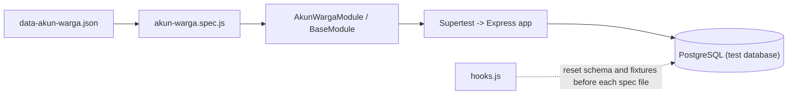

<!-- # Testing and troubleshooting -->

## Testing

There are two sets of automated tests. Both only cover the `akun-warga` resource, plus 2 tests for `GET /` and unknown routes.

| | Mocha + Supertest | Postman + Newman |
| --- | --- | --- |
| Calls the API through | Directly into the Express `app` (no port opened) | HTTP to a running server |
| Database | Dedicated test database, recreated automatically | The application database (`DB_NAME`), which must be in its sample data state |
| Count | 103 tests | 5 requests, with several tests in each |
| Report | Allure (HTML) | Terminal summary, optional HTML (`htmlextra`) |

### Mocha and Allure

#### Coverage

103 tests, made up of 98 data-driven cases, 3 password storage tests, and 2 application tests. Cases are read from `tests/data/data-akun-warga.json` and designed with **Equivalence Partitioning (EP)**, **Boundary Value Analysis (BVA)**, and **Decision Table** techniques.

| Case group | Count |
| --- | --- |
| POST, valid input | 13 |
| POST, invalid input | 30 |
| POST, decision table | 8 |
| PUT, field combinations (decision table) | 8 |
| PUT, EP and BVA | 12 |
| PUT, decision table | 8 |
| `:id` parameter | 10 |
| GET all and DELETE | 9 |

The extra tests check that the password is stored as a bcrypt hash (not plain text), changes on PUT with a new password, and does not change on PUT without a password.

#### How it works



- `BaseModule` sends the request for each case, then checks the status code, content-type, `message`, `status`, and the `errors` array. `AkunWargaModule` adds specific assertions (response columns, `password_hash` not leaking, and comparison with previously created data).
- Cases within one file run **in order** because some use IDs produced by earlier cases (the `{{AKUN_n}}` placeholder).
- Before each spec file, `hooks.js` rebuilds the schema from `reset.sql` and `schema.sql`, then loads fixtures: 1 RT and 16 residents, with no accounts. `seed.sql` is not used.

> [!CAUTION]
> The tests run `DROP TABLE` on the test database. For that reason `tests/env.setup.js` rejects database names that do not end in `_test`.

#### Parallel mode

`npm test` runs Mocha with `parallel: true` and `jobs: 4` (see `.mocharc.json`). In parallel mode, each worker uses its own database named `<DB_NAME_TEST>_w<worker number>` so a database reset in one worker does not disturb the others. These databases are created automatically if they do not exist, so the PostgreSQL user needs the `CREATEDB` privilege.

In serial mode (`npm run test:serial`), the tests use the `DB_NAME_TEST` database as is, and that database must already exist.

Parallelism only applies across spec files, and there are currently only two (`app.spec.js` and `akun-warga.spec.js`), so the speed-up is still small. The benefit shows once specs for other resources are added.

#### Running the Mocha tests

```bash
# 1. Create the test database (needed for serial mode)
psql -U postgres -h localhost -p 5432 -c "CREATE DATABASE kegiatan_desa_test;"

# 2. Make sure DB_NAME_TEST is in .env (see .env.example)

# 3. Run
npm test               # parallel
npm run test:serial    # serial
```

The server does not need to be running.

#### Allure report

```bash
npm run test:report    # runs the tests, then builds allure-report/
npm run report:open    # opens the report in the browser
```

`scripts/test-report.mjs` removes old results, runs Mocha with the `allure-mocha` reporter, then calls `allure generate`. The report is still built when some tests fail, and the script's exit code follows the test result.

In the report, each test gets the epic "Akun Warga", a `feature` matching its case group, and a test technique tag (EP, BVA, Decision Table), plus an attachment containing the JSON response.

> [!NOTE]
> `test:report` runs in serial mode (`--no-parallel`). When tried together with parallel mode, the `allure-results` folder was not created, and the cause has not been investigated. Allure calls in the test code go through `tests/helpers/allure.js`, which does nothing unless the `ALLURE_REPORT=1` variable is set (set automatically by `test-report.mjs`), so a plain `npm test` does not print Allure warnings.

#### Adding tests for other resources

1. Create `tests/data/data-<resource>.json` containing cases (same pattern as `data-akun-warga.json`).
2. Create `tests/modules/<resource>.module.js` that extends `BaseModule`, with `assertList` and `assertSingle`.
3. Create `tests/specs/<resource>.spec.js` that reads the cases from the module.

If the new resource needs fixture data beyond RT and residents, change `resetDatabase()` in `tests/helpers/db.js`.

### Postman and Newman

The collection is at `postman/API - Desa Sukamaju.postman_collection.json` and contains 5 requests for the `akun-warga` resource. Each request already has automated tests. The collection can be run through the Postman app or from the terminal with Newman.

#### Import and setup

1. Postman: **Import**, then choose the collection file in the `postman` folder.
2. Make sure the server is running and the database is in its sample data state (`npm run db:reset`).
3. Choose **No Environment**. The variables it needs are already in the collection.

> [!IMPORTANT]
> The tests compare results against the sample data from `seed.sql` (3 accounts, id 1 to 3). If the data has changed, run `npm run db:reset` before running the collection.

#### Collection variables

| Variable | Set by | Purpose |
| --- | --- | --- |
| `BASE_URL` | Collection | `http://localhost:3000` |
| `ENDPOINT_API` | Collection | `{{BASE_URL}}/api` |
| `AWID_jsonSchema` | Collection | JSON Schema for a single account response |
| `AWALL_jsonSchema` | Collection | JSON Schema for the account list response |
| `Account_Data` | Collection | POST request body. The `warga_id` value is replaced automatically by the pre-request script with a resident who has no account yet |
| `Account_Update` | Collection | PUT request body |
| `akun_id` | POST script | ID of the account under test, used in the URL of GET by ID, PUT, and DELETE |
| `akun_terakhir` | POST and PUT scripts | Latest account data, used as a comparison in other tests |

#### Run order

| No | Request | Status | What is tested |
| --- | --- | --- | --- |
| 1 | `POST` Tambah Akun Warga | 201 | Schema, data matches input, `akun_id` is saved. The pre-request script automatically picks a resident without an account |
| 2 | `GET` Semua Akun Warga | 200 | Schema, `total`, ID order, unique email and `warga_id`, the new account is in the list |
| 3 | `GET` Akun Warga Per ID | 200 | Schema, ID matches the URL, data contents match |
| 4 | `PUT` Ubah Akun Warga | 200 | The columns sent change, other columns do not |
| 5 | `DELETE` Hapus Akun Warga | 200 | The deleted data matches, a repeated `GET` returns 404, variables are cleared |

Several requests also verify that `password` and `password_hash` do not appear in the response and that the response time is under 500 ms.

The order above must not be changed, because `akun_id` is only available after POST succeeds and DELETE is deliberately last. Requests can be run one by one or through the **Collection Runner** (1 iteration). Because DELETE cleans up the account created by POST, the whole sequence can be repeated without changing the sample data, as long as all requests succeed.

#### Running with Newman

With the server running, open a second terminal and run:

```bash
npm run test:api
```

This runs the collection with a 200 ms delay between requests. The number of `requests` in the Newman summary is higher than 5 because scripts inside the collection call extra API requests: the POST pre-request fetches the account and resident lists (2 requests), and the DELETE script does a `GET` again to confirm the data was really deleted (1 request).

To also generate an HTML report (output at `postman/report.html`):

```bash
npm run test:api:report
```

### Manual tests for other resources

Resources other than `akun-warga` have no automated tests yet. Some scenarios to try manually:

| Scenario | Request | Result |
| --- | --- | --- |
| ID does not exist | `GET /api/warga/9999` | 404 |
| ID is not a number | `GET /api/warga/abc` | 400 |
| Validation fails | `POST /api/warga` with `"nik": "123"` | 400 |
| Duplicate NIK | `POST /api/warga` with the same NIK twice | 409 |
| Resident already has an account | `POST /api/akun-warga` with `"warga_id": 1` (sample data) | 409 |
| Activity already finished | `POST /api/pendaftaran-kegiatan` with `"kegiatan_id": 4` (sample data) | 409 |
| Already registered | `POST /api/pendaftaran-kegiatan` with `{ "warga_id": 1, "kegiatan_id": 1 }` (sample data) | 409 |
| RT still has residents | `DELETE /api/rt/1` (sample data) | 409 |
| Times out of order | `POST /api/kegiatan` with `jam_selesai` earlier than `jam_mulai` | 400 |

## Troubleshooting

Error messages printed by the app are in Indonesian, so they are quoted as is below.

| Symptom | Cause and solution |
| --- | --- |
| `Gagal terhubung ke database` when the server starts | Check the contents of `.env` (host, port, user, password, database name) and make sure PostgreSQL is running |
| `EADDRINUSE` | The port is already in use. Change `PORT` in `.env` or stop the process using port 3000 |
| `relation "warga" does not exist` | The tables have not been created. Run `npm run db:reset` |
| `psql` is not recognized | PostgreSQL's `bin` folder is not in `PATH`. Add it, then reopen the terminal |
| POST account returns 409 `warga ini sudah punya akun` ("this resident already has an account") | Pick a `warga_id` that has no account yet. In the sample data, accounts belong to residents with id 1, 2, and 4 |
| `npm run db:reset` hangs or fails at `DROP TABLE` | The server is still running and holding a connection. Stop the server first |
| `npm run db:reset`: `DB_NAME / DB_PASSWORD tidak ditemukan di .env` ("not found in .env") | Fill in `DB_NAME` and `DB_PASSWORD` in the `.env` file |
| Mocha tests: `Database test harus berakhiran "_test"` ("test database must end in `_test`") | Set `DB_NAME_TEST` in `.env` to a name ending in `_test`, for example `kegiatan_desa_test` |
| Mocha tests, serial: `database "..._test" does not exist` | Create the test database first: `CREATE DATABASE kegiatan_desa_test;` |
| Mocha tests, parallel: `permission denied to create database` | The PostgreSQL user lacks the `CREATEDB` privilege. Grant it, or create the `<DB_NAME_TEST>_w<n>` databases manually |
| Repeated warning `no test runtime is found` | The `ALLURE_REPORT=1` variable is still set in the terminal (PowerShell: `Remove-Item Env:ALLURE_REPORT`), or test code calls `allure-js-commons` directly instead of through `tests/helpers/allure.js` |
| `No test results directories found matching pattern: ./allure-results` | Mocha did not produce Allure data. Run `npx mocha --no-parallel --reporter allure-mocha` and check whether the `allure-results` folder is populated |
| Postman or Newman tests fail on seed data, for example `expected 4 to deeply equal 3` | The data has changed from its initial state (usually a leftover account from a run that failed midway). Run `npm run db:reset` |
| Newman: `SyntaxError: Identifier 'data' has already been declared` | The test script declares `const data`, but the name `data` is already used by the Newman sandbox. The collection in the repo already fixes this. If the collection is re-exported from Postman, wrap the test script body in `(() => { ... })();` or rename the variable |
| Newman: request to `/akun-warga/{{akun_id}}` returns 400 | `akun_id` is empty because POST did not succeed or the request order in the collection changed. Make sure the order is POST, GET all, GET by ID, PUT, DELETE |
| Postman request goes to the wrong address | Another environment has a `BASE_URL` variable. Choose **No Environment** |
| Code page warning when using `psql` on Windows | It is only an 8-bit character warning and does not affect data |
| `npm audit` reports many vulnerabilities after `npm install` | Most are reported in development dependencies (for example Newman). Check `npm audit` for details, and avoid `npm audit fix --force` because it can change package versions drastically |